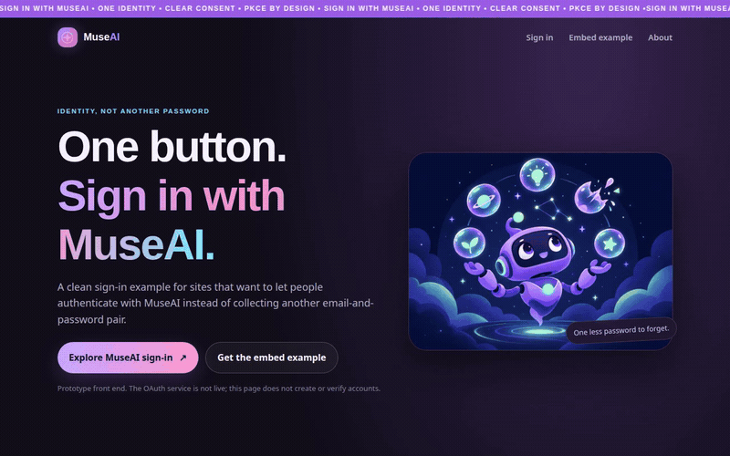
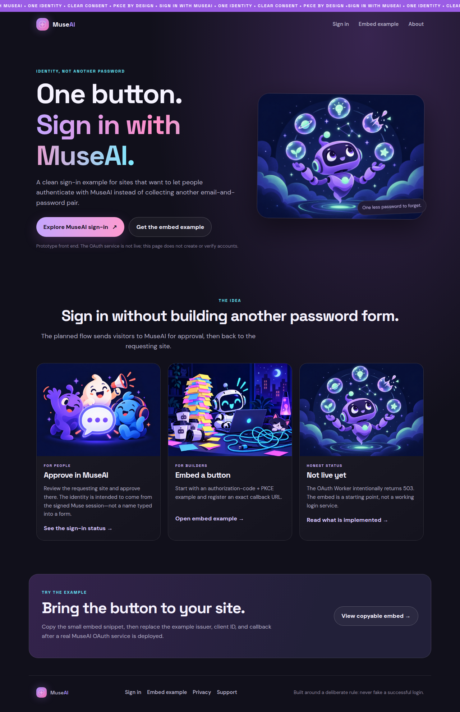
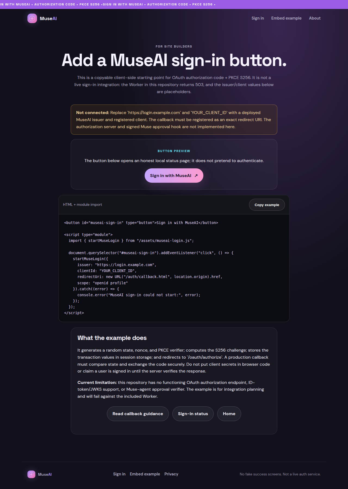
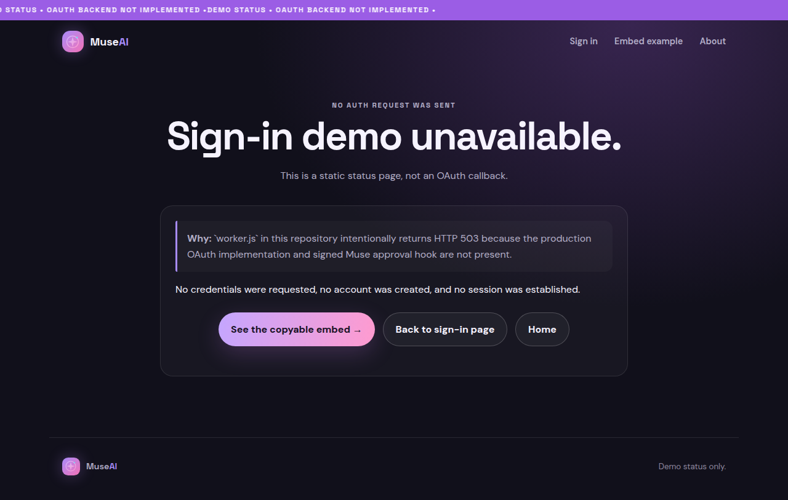

# Sign in with MuseAI

**A copyable MuseAI login-button example with OAuth + PKCE S256—paired with a static demo that is honest about the fact that its sign-in server is not live.**

## Why this exists

Sites that want MuseAI sign-in need more than a button: they need a safe authorization redirect, a registered callback, PKCE, state validation, and a real server that can verify the Muse approval. This repository makes the client-side starting point easy to inspect without adding another email/password form.

The important distinction: the **embed example is real client code**, but the authorization server is not implemented. The Worker returns HTTP 503 by design. Nothing here can create an account, authenticate a person, or establish a session.

## See it work

**Live demo: unavailable.** This checkout has no Git remote, live URL, or configured GitHub Pages/Cloudflare Pages deployment.

Run the actual static site locally:

```bash
python3 -m http.server 8000 --directory site
```

Open <http://127.0.0.1:8000> and choose **Embed example**. The short recording follows the real local pages from the landing screen to the copyable snippet and then to the honest “not available” status page; it does not contact an auth service or sign anyone in.



[Download the WebM walkthrough](site/assets/demo/demo.webm) · [Open the copyable embed page](site/embed-demo.html) · [Hosting notes](docs/HOSTING.md)

## Screenshots

| MuseAI sign-in landing page | Copyable PKCE embed example |
|---|---|
|  |  |

**Honest service status**



Screenshots were captured from the running static site—not generated mockups.

## Quick start

The website is static HTML/CSS/JavaScript and needs no install or build step:

```bash
python3 -m http.server 8000 --directory site
```

The client helper at [`site/assets/museai-login.js`](site/assets/museai-login.js) creates random `state`, `nonce`, and PKCE verifier values, computes an S256 challenge, and builds an authorization-code redirect. The copyable example is [`site/embed-demo.html`](site/embed-demo.html).

To run the repository checks (Node.js 20+):

```bash
npm test       # asserts the OAuth Worker fails closed with 503
npm run check  # syntax-checks the Worker and browser login helper
```

## What is—and is not—implemented

| Component | Current state |
|---|---|
| MuseAI sign-in landing and embed example | Runs locally as a static site; example uses placeholder issuer/client values. |
| Browser PKCE request helper | Implemented as a client-side example; it does not exchange codes or authenticate users. |
| OAuth Worker and signed Muse approval | **Not implemented.** `worker.js` returns 503. Do not use real accounts. |
| GitHub Pages / Cloudflare Pages | Both could serve the `site/` directory, but neither is configured or deployed here. |
| Legacy community and age-gated payment pages | Retained as secondary static pages; not part of the sign-in flow. Age checkbox is self-attestation only. |

## Repository map

- [`site/`](site/) — MuseAI login landing, PKCE embed example, status/callback guidance, plus secondary pages.
- [`docs/MUSE-APPROVAL-PROTOCOL.md`](docs/MUSE-APPROVAL-PROTOCOL.md) — proposed signed Muse approval protocol.
- [`docs/HOSTING.md`](docs/HOSTING.md) — static hosting options; no deployment performed.
- [`prompts/`](prompts/) — bounded implementation prompts for the planned OAuth server.
- [`src/`](src/) — fail-closed server-side scaffolds; handlers are not implemented.
- [`tests/`](tests/) — offline Node tests.

## Safety boundary

The login page never asks for credentials and never displays a fake authenticated state. Do not deploy the OAuth Worker or use it for real accounts until authorization, token issuance, ID-token/JWKS validation, Muse signature verification, atomic one-time state, and security review are complete. The embed is an integration example—not a live identity provider.
